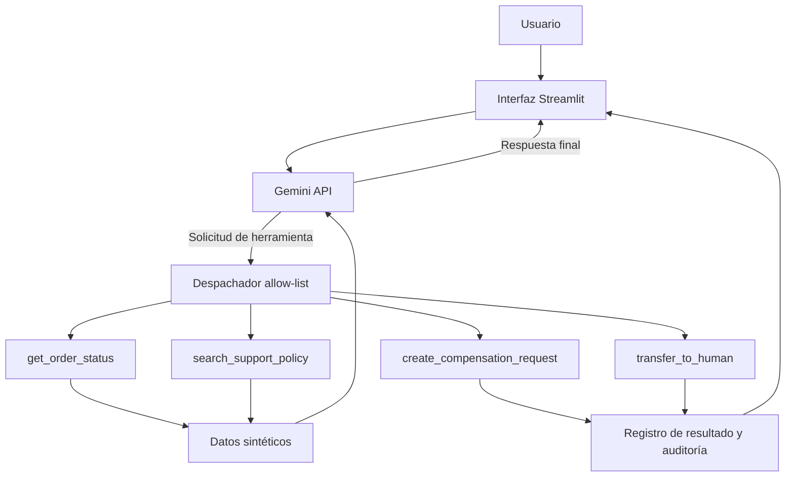

# SupportPilot — AI Support Agent

**Prototipo de agente conversacional para soporte al cliente con herramientas backend controladas, auditoría de acciones y transferencia simulada a una persona.**

SupportPilot demuestra cómo un modelo de lenguaje puede solicitar funciones concretas del backend para consultar información ficticia y proponer acciones con límites explícitos. Está diseñado como proyecto educativo de portafolio para explorar patrones de agentes de IA en procesos de soporte.

> **Alcance y seguridad:** proyecto personal e independiente, no afiliado ni conectado con sistemas de empresas reales. Todos los pedidos y políticas son sintéticos. Las compensaciones y las transferencias son simuladas; no se realizan pagos, reembolsos ni notificaciones a agentes reales.

## Qué demuestra

- Integración de un LLM mediante Gemini API.
- Function calling para solicitar la ejecución de funciones específicas del backend.
- Despachador de herramientas con lista permitida.
- Consulta de pedidos ficticios y búsqueda inicial de políticas por palabras clave.
- Registro de solicitudes de compensación simuladas sujetas a revisión humana.
- Creación de tickets ficticios para transferencia a soporte humano.
- Registro de auditoría de las herramientas utilizadas durante la conversación.
- Pruebas unitarias para la lógica de negocio.

## Arquitectura



El modelo interpreta la consulta y puede solicitar una de las herramientas definidas. El backend ejecuta solo las funciones permitidas y devuelve los resultados al flujo conversacional. La salida del modelo no sustituye las validaciones de negocio: las herramientas son responsables de consultar o registrar los datos simulados.

Consulta [`docs/architecture.md`](docs/architecture.md) para detalles y [`docs/evaluation.md`](docs/evaluation.md) para casos de prueba y métricas propuestas.

## Herramientas disponibles

| Herramienta | Responsabilidad | Límite de la demo |
|---|---|---|
| `get_order_status` | Consulta el estado de un pedido ficticio | No consulta ninguna plataforma externa |
| `search_support_policy` | Busca políticas de soporte por palabras clave | No es RAG vectorial |
| `create_compensation_request` | Registra una solicitud de compensación | No aprueba ni emite pagos o reembolsos |
| `transfer_to_human` | Registra un ticket de escalamiento | No notifica a un agente real |

## Tecnologías

- Python
- Streamlit
- Google Gen AI SDK (`google-genai`) y Gemini API
- `python-dotenv`
- `unittest`

## Estructura del repositorio

```text
supportpilot-ai-agent/
├── app.py                       # Interfaz Streamlit y coordinación del agente
├── support_tools.py             # Herramientas y lógica de negocio simulada
├── tests/
│   └── test_support_tools.py    # Pruebas unitarias
├── docs/
│   ├── architecture.md          # Arquitectura y límites
│   └── evaluation.md            # Casos y métricas sugeridas
├── .streamlit/
│   └── config.toml
├── .env.example
├── .gitignore
├── requirements.txt
└── README.md
```

## Requisitos

- Python instalado y disponible desde PowerShell, o conocer la ruta completa a `python.exe`.
- Conexión a internet.
- Una clave API de Google AI Studio para conversar con el modelo. Revisa en Google AI Studio los modelos habilitados, la cuota vigente y las condiciones de uso de tu cuenta.

## Instalación en Windows

Abre PowerShell en la carpeta del repositorio.

```powershell
python -m venv .venv
```

Si `python` no se reconoce y tu instalación está en el directorio de perfil de Windows, puedes utilizar una ruta directa (ajusta la versión y ubicación si son diferentes):

```powershell
& "$env:LocalAppData\Programs\Python\Python313\python.exe" -m venv .venv
```

Instala las dependencias:

```powershell
.\.venv\Scripts\python.exe -m pip install --upgrade pip
.\.venv\Scripts\python.exe -m pip install -r requirements.txt
```

Crea la configuración local:

```powershell
Copy-Item .env.example .env
```

Edita `.env` en tu computador y añade una clave API válida:

```dotenv
GEMINI_API_KEY=TU_CLAVE_API
GEMINI_MODEL=gemini-3.8-flash
```

El modelo debe estar disponible en tu cuenta; revisa el catálogo oficial de Gemini si recibes un error de modelo o cuota. **Nunca subas `.env` ni claves API a GitHub.** Si una clave se comparte por error, revócala y crea una nueva.

## Ejecutar la aplicación

Para desarrollo local, enlaza Streamlit al propio computador:

```powershell
.\.venv\Scripts\python.exe -m streamlit run app.py --server.address 127.0.0.1
```

Abre [http://127.0.0.1:8501](http://127.0.0.1:8501).

## Ejecutar pruebas

Desde la raíz del repositorio:

```powershell
.\.venv\Scripts\python.exe -m unittest discover -s tests -v
```

Las pruebas cubren la lógica de las herramientas backend. No reemplazan una prueba de integración con Gemini ni una evaluación en producción.

## Escenarios de prueba manual

1. `¿Dónde está mi pedido DM-1002?`
2. `Mi pedido llegó tarde, ¿qué política aplica?`
3. `Solicito una compensación para DM-1002.`
4. `Quiero hablar con una persona.`
5. `El producto me causó una reacción alérgica.`

Verifica tanto el texto de respuesta como la sección de auditoría de herramientas. Para compensaciones y transferencias, comprueba que el resultado indique que la acción es simulada y pendiente de revisión cuando corresponda.

## Configuración de despliegue (opcional)

Para una demostración web se puede usar Streamlit Community Cloud conectando este repositorio y seleccionando `app.py` como archivo de entrada. Configura la clave en los secretos de la plataforma, no en el código ni en el README. Comprueba la cuota del modelo y no uses datos reales de clientes.

## Limitaciones conocidas

- No es un sistema productivo y no tiene conexión a pedidos, pagos, políticas ni herramientas de contact center reales.
- La búsqueda de políticas es por palabras clave; todavía no implementa RAG con embeddings o búsqueda vectorial.
- No implementa MCP, WhatsApp, Amazon Connect, autenticación de usuarios ni autorización empresarial.
- Las métricas de resolución, calidad, latencia y coste aún no han sido medidas con un conjunto de evaluación representativo.
- Las solicitudes de compensación y los tickets son datos simulados en el proceso local; no deben interpretarse como acciones reales.
- El servicio depende de la disponibilidad, cuota y modelo habilitado en Gemini API.

## Roadmap

1. Extraer las herramientas a una API REST con FastAPI y añadir pruebas de integración.
2. Integrar la recuperación vectorial de [`Support Knowledge RAG API`](https://github.com/julianandreszapata/support-knowledge-rag-api).
3. Añadir detección de baja confianza, política de escalamiento y manejo explícito de errores del proveedor LLM.
4. Crear un conjunto de evaluación y medir calidad de respuesta, uso de herramientas, escalamiento, latencia y costo.
5. Explorar MCP con herramientas de lectura/escritura claramente autorizadas.
6. Agregar autenticación, observabilidad, límites de solicitudes y despliegue seguro.

## Autor

**Julian Zapata** — Software Engineer enfocado en backend, APIs, integraciones y prototipos de IA.

- GitHub: [julianandreszapata](https://github.com/julianandreszapata)
- LinkedIn: [linkedin.com/in/julianandreszapata](https://www.linkedin.com/in/julianandreszapata/)

---

*Proyecto personal de portafolio. Describe un prototipo y no debe interpretarse como experiencia de producción ni como una integración oficial con Rappi.*
